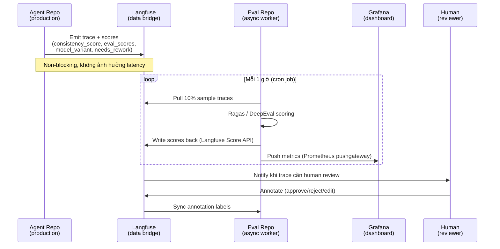
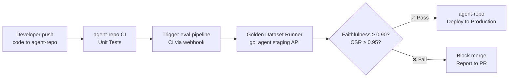

# 🏗️ Tách Evaluation Pipeline — Phân Tích Kiến Trúc

> Phân tích dựa trên codebase thực tế: `chat_stream_service.py`, `workflow.py`, `config.py`, `metrics.py`

---

## Câu Trả Lời Ngắn

**Hoàn toàn có thể tách — và đây là quyết định đúng về mặt kiến trúc.**
Nhưng cần hiểu rõ **đường ranh giới tách** và **cơ chế truyền data** giữa 2 repo,
vì hiện tại có một số điểm **coupling chặt** cần xử lý trước.

---

## 1. Phân Tích Coupling Hiện Tại

```
agent-repo (source hiện tại)
│
├── TIGHTLY COUPLED — không thể tách trực tiếp
│   ├── node_fact_checker()          ← trong hot path của LangGraph workflow
│   ├── node_evaluator_agent()       ← điều khiển rework loop (needs_rework flag)
│   ├── AgentState.fact_check_result ← được đọc/ghi bởi nhiều nodes
│   └── route_from_evaluator()       ← routing logic phụ thuộc evaluator output
│
└── CÓ THỂ TÁCH — chỉ đọc data, không ảnh hưởng flow
    ├── Langfuse callback (chat_stream_service.py:106)  ← đã là async, non-blocking
    ├── Prometheus metrics emit                          ← fire-and-forget
    ├── Golden Dataset evaluation                        ← chạy offline
    ├── A/B comparison scoring                           ← chạy async sau request
    ├── Human review queue                               ← async workflow
    └── DeepEval / Ragas scoring                         ← offline batch job
```

> [!IMPORTANT]
> `node_fact_checker` và `node_evaluator_agent` hiện tại **điều khiển trực tiếp** luồng xử lý
> (quyết định rework hay không). Nếu tách 2 node này ra repo ngoài, bạn phải gọi network
> trong hot path → **tăng latency đáng kể**. Đây là phần **không nên tách**.

---

## 2. Đường Ranh Giới Tách Đúng

```
┌─────────────────────────────────────────────────────────────────┐
│                     AGENT REPO (giữ nguyên)                     │
│                                                                  │
│  input_guardrail → planner → executor → fact_checker →          │
│  evaluator_agent → final_synthesizer                             │
│         │                                                        │
│         │ emit events (non-blocking)                             │
│         ▼                                                        │
│  ┌─────────────────────────────────────────────────┐            │
│  │  LANGFUSE  (data bridge - đã có sẵn container)  │            │
│  │  - Traces với metadata đầy đủ                   │            │
│  │  - consistency_score, eval_scores               │            │
│  │  - model_variant tag (A/B)                      │            │
│  │  - fact_check_result, needs_rework              │            │
│  └─────────────────────────────────────────────────┘            │
└─────────────────────────────────────────────────────────────────┘
                              │
                              │ Pull data (async, scheduled)
                              ▼
┌─────────────────────────────────────────────────────────────────┐
│               EVAL-PIPELINE REPO (repo mới)                      │
│                                                                  │
│  ├── offline_evaluator/                                          │
│  │   ├── ragas_scorer.py          (Faithfulness, Relevance)      │
│  │   ├── deepeval_runner.py       (CI/CD regression tests)       │
│  │   └── deterministic_checker.py (price, date, entity rules)    │
│  │                                                               │
│  ├── ab_testing/                                                 │
│  │   ├── traffic_analyzer.py      (so sánh variant A vs B)       │
│  │   ├── significance_test.py     (Mann-Whitney U, chi-square)   │
│  │   └── winner_report.py                                        │
│  │                                                               │
│  ├── human_review/                                               │
│  │   ├── review_queue.py          (pull flagged traces)          │
│  │   ├── annotation_api.py        (Langfuse Score API)           │
│  │   └── notification.py         (Slack/email alert)             │
│  │                                                               │
│  ├── golden_dataset/                                             │
│  │   ├── dataset.json             (ground truth Q&A pairs)       │
│  │   ├── benchmark_runner.py      (chạy test cases)              │
│  │   └── regression_report.py                                    │
│  │                                                               │
│  └── dashboard/                                                  │
│      ├── grafana_panels/          (JSON panel definitions)        │
│      └── metrics_exporter.py     (push custom metrics)           │
└─────────────────────────────────────────────────────────────────┘
```

---

## 3. Cơ Chế Truyền Data: Event-Driven qua Langfuse

Langfuse đóng vai trò **data bridge** — không phải pipeline trực tiếp.
Agent repo **push data vào Langfuse**, eval repo **pull data từ Langfuse**.



### Thứ gì Agent Repo push lên Langfuse

```python
# Thêm vào chat_stream_service.py — sau khi graph chạy xong
# (non-blocking, trong finally block)

async def _emit_quality_scores_to_langfuse(
    langfuse_handler,
    trace_id: str,
    final_state: dict,
    model_variant: str
):
    """Push evaluation data lên Langfuse để eval repo có thể pull."""
    if not langfuse_handler:
        return

    fact_result = final_state.get("fact_check_result", {})
    
    # Score 1: Consistency từ fact_checker
    if fact_result.get("consistency_score") is not None:
        langfuse.score(
            trace_id=trace_id,
            name="consistency_score",
            value=fact_result["consistency_score"],
            data_type="NUMERIC"
        )
    
    # Score 2: Contradiction count — dễ dùng cho alert
    langfuse.score(
        trace_id=trace_id,
        name="contradiction_count",
        value=len(fact_result.get("contradictions", [])),
        data_type="NUMERIC"
    )

    # Metadata cho A/B filtering
    # (đã được set khi tạo trace qua model_variant tag)
```

### Thứ gì Eval Repo pull từ Langfuse

```python
# eval-pipeline/offline_evaluator/langfuse_puller.py

from langfuse import Langfuse
import random

langfuse = Langfuse()

def pull_sample_traces(
    experiment_name: str = "model_comparison_v1",
    sample_rate: float = 0.10,
    hours_back: int = 1
) -> list[dict]:
    """Pull 10% traces từ Langfuse để score offline."""
    
    traces = langfuse.fetch_traces(
        tags=[experiment_name],
        from_timestamp=datetime.utcnow() - timedelta(hours=hours_back),
        limit=1000,
    ).data
    
    # Stratified sample: giữ tỷ lệ A/B
    variant_a = [t for t in traces if t.metadata.get("experiment.variant") == "model_a"]
    variant_b = [t for t in traces if t.metadata.get("experiment.variant") == "model_b"]
    
    sampled_a = random.sample(variant_a, int(len(variant_a) * sample_rate))
    sampled_b = random.sample(variant_b, int(len(variant_b) * sample_rate))
    
    return sampled_a + sampled_b
```

---

## 4. Cấu Trúc Repo Mới Đề Xuất

```
eval-pipeline/
├── README.md
├── pyproject.toml              # dependencies: ragas, deepeval, langfuse, prometheus-client
├── .env.example                # LANGFUSE_PUBLIC_KEY, LANGFUSE_SECRET_KEY, LANGFUSE_HOST
│
├── config/
│   ├── thresholds.yaml         # faithfulness_min: 0.90, csr_min: 0.95, ...
│   └── ab_test_config.yaml     # experiment_name, min_sample_size, significance_level
│
├── evaluators/
│   ├── __init__.py
│   ├── ragas_scorer.py         # Faithfulness, AnswerRelevance, ContextRecall
│   ├── deepeval_runner.py      # HallucinationMetric, FaithfulnessMetric
│   └── deterministic.py        # price_check, date_check, entity_check (zero LLM)
│
├── ab_testing/
│   ├── analyzer.py             # Pull traces, group by variant, compute metrics
│   ├── significance.py         # Mann-Whitney U test, chi-square
│   └── report.py               # Generate comparison report
│
├── human_review/
│   ├── queue_manager.py        # Poll Langfuse for traces needing review
│   ├── notifier.py             # Slack webhook / email
│   └── annotation_client.py   # Langfuse Score API wrapper
│
├── golden_dataset/
│   ├── dataset.json            # [{question, expected_tool, expected_answer, constraints}]
│   ├── runner.py               # Gọi agent API → so sánh với expected output
│   └── report.py
│
├── workers/
│   ├── hourly_scorer.py        # Cron: pull → score → push metrics (mỗi 1h)
│   └── ci_regression.py        # CI/CD: chạy golden dataset trước khi deploy
│
└── tests/
    └── test_deterministic.py   # Unit test cho deterministic checker
```

---

## 5. Trade-off: Tách vs Giữ Chung

| Tiêu chí | Tách repo riêng | Giữ chung trong agent repo |
|---|---|---|
| **Deployment độc lập** | ✅ Deploy eval mà không ảnh hưởng production | ❌ Phải deploy cả agent để update eval |
| **Team phân quyền** | ✅ Data/ML team quản lý eval riêng | ❌ Phụ thuộc backend team |
| **Latency production** | ✅ Eval chạy async, không block request | ✅ Tương đương nếu thiết kế đúng |
| **Debug & trace** | ⚠️ Cần Langfuse làm bridge, phức tạp hơn | ✅ Đọc state trực tiếp từ AgentState |
| **Data freshness** | ⚠️ Có delay (eval chạy mỗi 1h) | ✅ Real-time nếu chạy inline |
| **Độ phức tạp setup** | ⚠️ Cần thêm infra (cron, pushgateway) | ✅ Đơn giản hơn ban đầu |
| **Scale riêng** | ✅ Scale eval worker độc lập | ❌ Chia sẻ tài nguyên với agent |

> [!NOTE]
> **Recommendation:** Tách repo là lựa chọn đúng dài hạn. Nhưng phần **inline trong agent**
> (fact_checker, evaluator_agent) vẫn giữ nguyên — chúng điều khiển runtime behavior.
> Repo mới chỉ chịu trách nhiệm **đo lường và phân tích offline**.

---

## 6. Điều Kiện Cần Làm Trước Khi Tách

Hiện tại Agent Repo cần bổ sung trước để Eval Repo có data để pull:

### Việc cần làm ở Agent Repo

- [ ] **Emit `consistency_score` và 4 eval scores lên Langfuse** (hiện chỉ có trong log)
- [ ] **Thêm `model_variant` vào trace metadata** (cơ sở cho A/B filtering)
- [ ] **Emit `forced_accept` event lên Langfuse** (khi rework limit reached)
- [ ] **Đảm bảo `LANGFUSE_PUBLIC_KEY` được set** trong production env
  (hiện tại code đã có `if getattr(settings, "LANGFUSE_PUBLIC_KEY", None)` — chỉ cần set key)

### Việc cần làm ở Eval Repo mới

- [ ] Setup Langfuse SDK với credentials của Langfuse server đang chạy
- [ ] Implement cron job `hourly_scorer.py`
- [ ] Implement `golden_dataset/runner.py` gọi qua HTTP API của agent
- [ ] Setup CI/CD chạy `ci_regression.py` trước mỗi lần deploy agent

---

## 7. Luồng CI/CD Kết Hợp Cả 2 Repo



---

## 8. Tóm Tắt Quyết Định

```
GIỮ TRONG AGENT REPO                  TÁCH RA EVAL REPO
─────────────────────────────          ──────────────────────────────
✅ node_fact_checker                   ✅ Ragas / DeepEval scoring
✅ node_evaluator_agent                ✅ A/B testing analyzer
✅ route_from_evaluator (rework)       ✅ Human review queue & notifier
✅ AgentState.fact_check_result        ✅ Golden dataset runner
✅ Prometheus inline metrics           ✅ CI/CD regression gate
✅ Langfuse callback (push data)       ✅ Grafana panel definitions
                                       ✅ Statistical significance tests
                                       ✅ Deterministic checker (offline)
```

**Langfuse = điểm trung gian, là "API" giữa 2 repo.**
Agent repo push data, Eval repo pull data — hoàn toàn decoupled.
```
